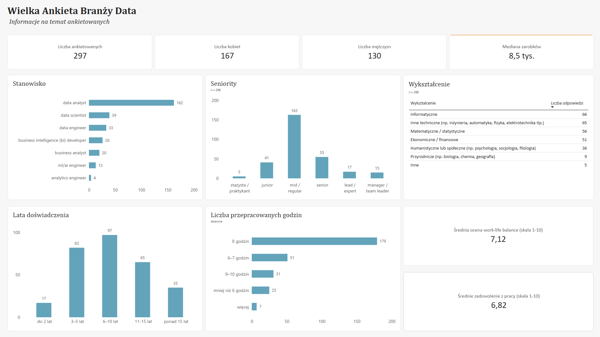

## Wielka Ankieta Branży Data - raport Power BI

Interaktywny raport na podstawie ankiety, przeprowadzonej wsród osób pracujących w branży data.
W tym raporcie skupiam się na informacjach ogólnych o ankietowanych oraz bardziej szczegółowo analizuję chęć zmiany pracy i jej powody.

## Przegląd - dashboardy

## Przegląd - informacje o raporcie

- Informacje na temat ankietowanych: stanowisko, lata doświadczenia, seniority, wykształcenie, średnia ocena dotycząca work-life balance, średnie zadowolenie z pracy,
- Chęć zmiany pracy (deklaruje 50,17%) i jej powody. Najczęściej wymienianym powodem są niskie zarobki (60,4%).
   - Szczegóły dotyczące odczuć względem wynagrodzenia, przybliżenie danych o podwyżkach i systemie premiowym.

## Dane i narzędzia
- Źródło danych: Crappy Data Club, Wyzwanie: Wielka Ankieta Branży Data
- Przygotowanie danych: SQL (queries_ankieta.sql)
- Wizualizacja: Power BI (ankieta_data_info_zmiana_pracy.pbix)

## Zawartość repozytorium
- `[ankieta_data_info_zmiana_pracy].pbix` – raport (do otwarcia potrzebny darmowy Power BI Desktop, Windows)
- `[queries_ankieta].sql` – zapytania przygotowujące dane
- `images/` – zrzuty ekranu raportu, zrzuty ekranu w pdf

## Autorka
Justyna Karczmarz, [https://www.linkedin.com/in/justyna-karczmarz-51ab06446/]
